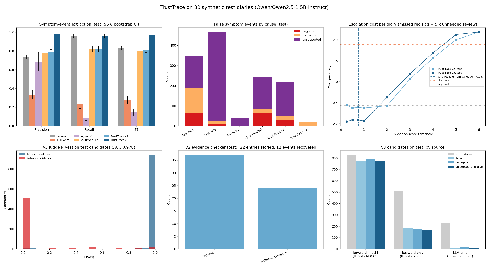

# TrustTrace: an evidence-grounded LLM agent for messy patient symptom diaries

[](https://colab.research.google.com/github/AdamDebs/trusttrace-llm-agent/blob/main/TrustTrace.ipynb)

Patients often record symptoms as messy daily notes: slang, typos, skipped days, entries out of order, and phrases that only *sound* like symptoms ("sick of this weather", "had red wine"). A language model that summarises these notes for a clinician has two jobs that pull against each other: it must not invent symptoms, and it must not miss a red flag.

This project follows on from [TrustTriage](https://github.com/AdamDebs/trusttriage-medmnist), where I studied how a medical classifier should make decisions when a missed case costs far more than a false alarm. Here I ask the same question of a language model agent: can it summarise a patient's diary faithfully, and decide when to escalate to a clinician, when errors have unequal costs?

**Result:** on 80 held-out synthetic diaries, the final agent (TrustTrace v3) reached an F1 of 0.970 for symptom-event extraction, against 0.831 for a keyword baseline, and cut false symptom events from 350 to 20, using a 1.5B-parameter model on a free Colab GPU.

## How the agent works

For each 14-day diary, TrustTrace v3:

1. **Proposes candidates from two sources.** A keyword tool and an LLM extraction step (Qwen2.5-1.5B-Instruct, one entry at a time, answering with numbered phrases) each suggest (phrase, symptom) pairs. Candidates whose phrase is negated ("no blood today") are dropped by a deterministic check.
2. **Judges every candidate.** The model is asked a yes/no question, for example *Does "jeans are loose" say the patient had diarrhoea?* The probability of "yes" is read directly from the model's next-token scores, so there is no free text to parse.
3. **Accepts candidates above a threshold** for each source (keyword and LLM agree, keyword only, LLM only). The three thresholds are chosen on validation diaries to maximise F1.
4. **Computes trends** (worsening, improving, stable) from accepted events only.
5. **Summarises** for a clinician from accepted facts, then **checks the summary**: every symptom and number it mentions must be supported, and any red flag must appear. A summary that fails is replaced by a template built only from the facts.
6. **Escalates** using an evidence score whose threshold is chosen on validation data so that a missed red flag costs 5x an unnecessary review.

## What I learned building it

* **Agent v1** asked the model for every symptom in the whole diary in one prompt. With a 1.5B model it found about 8% of the true symptom events.
* **The first per-entry version** asked for symptoms with free-text quotes, using one example in the prompt. The model copied that example into most answers: 1,462 quotes did not appear in their entry, and retries recovered only 6 events.
* **Agent v2** stopped the model writing evidence at all: it points at numbered phrases instead, guided by worked examples whose phrases never appear in the data, and a deterministic checker sends rejected answers back with the reason. This raised F1 to 0.806, but the keyword baseline still found more symptoms (recall 95.9% against 82.2%).
* **Agent v3** stopped treating keywords and the model as competitors. Keywords are good at finding candidates and the model is good at rejecting the wrong ones, so v3 uses keywords and the model to propose, and the model's yes/no probability to decide. This kept the keyword baseline's recall while raising precision from 73.3% to 98.0%.

## Comparison

All methods run on the same diaries in the same notebook:

* **Keyword baseline:** a symptom lexicon with negation handling.
* **LLM only:** the same model asked for the symptoms, a summary and an escalation decision in one prompt, with no tools.
* **Agent v1:** one extraction prompt for the whole diary, then verification, summary and escalation.
* **TrustTrace v2**, and v2 before verification, to isolate what the evidence checker adds.
* **TrustTrace v3 (hybrid):** the final agent described above.

## Evaluation

The diaries are synthetic, with exact ground truth, so every invented symptom can be counted. They include slang, negations, distractor phrases, filler, one-word entries, skipped days and out-of-order entries. Metrics:

* **Faithfulness:** precision of extracted symptom events, with false events split into negation errors, distractor errors and unsupported claims.
* **Coverage:** recall of true symptom events.
* **Summary claims:** precision of the symptoms each summary asserts.
* **Escalation:** cost per diary, missed escalations and unneeded reviews.
* **Judge quality:** how well the yes/no probability separates true from false candidates (AUC) and how well calibrated it is (expected calibration error, ECE).
* **Uncertainty:** 95% bootstrap confidence intervals over diaries.

Every threshold (judge thresholds and escalation thresholds) is chosen on 40 validation diaries; the 80 test diaries are used only for the final numbers. The notebook also exports `human_check.csv`, a sheet of 30 test cases for checking summaries by hand; I have not included it in this repository.

## Results

80 synthetic test diaries (1,001 true symptom events; 35 diaries need escalation), Qwen2.5-1.5B-Instruct on a Colab T4 GPU.

| Method | Precision | Recall | F1 | Negation errors | Distractor errors | Escalation cost per diary | Missed escalations (of 35) | Unneeded reviews |
|---|---|---|---|---|---|---|---|---|
| Keyword baseline | 73.3% | 95.9% | 0.831 | 63 | 125 | 0.438 | 0 | 35 |
| LLM only (same model, one prompt) | 33.4% | 23.4% | 0.275 | 12 | 11 | 1.887 | 30 | 1 |
| Agent v1 (whole diary) | 68.1% | 8.1% | 0.145 | 0 | 2 | 1.725 | 27 | 3 |
| TrustTrace v2 before verification | 77.3% | 82.2% | 0.797 | 62 | 21 | 0.400 | 1 | 27 |
| TrustTrace v2 | 79.1% | 82.2% | 0.806 | 31 | 21 | 0.375 | 1 | 25 |
| **TrustTrace v3 (hybrid)** | **98.0%** | **96.0%** | **0.970** | **1** | **17** | **0.087** | 1 | **2** |

95% bootstrap intervals for TrustTrace v3: precision 96.9%–98.8%, recall 94.3%–97.4%, F1 0.960–0.979, escalation cost 0.000–0.225. For the keyword baseline: F1 0.813–0.848, escalation cost 0.338–0.550.

Full tables are in [`results/summary.md`](results/summary.md), all metrics in [`results/metrics.json`](results/metrics.json), worked examples in [`results/examples.md`](results/examples.md), and samples of raw model outputs and judge probabilities in `results/raw_samples.jsonl`.



## Findings

* **Combining keywords and the model beat both.** TrustTrace v3 matched the keyword baseline's recall (96.0% against 95.9%) while raising precision from 73.3% to 98.0%. Its F1 interval (0.960–0.979) does not overlap the keyword baseline's (0.813–0.848) or v2's (0.783–0.829).
* **The yes/no judge is accurate and well calibrated.** On 1,570 test candidates, its probability separated true from false candidates with an AUC of 0.978 (0.962 on validation), with an expected calibration error of 0.040.
* **Each source plays a different role.** When the keyword tool and the LLM agreed, 778 of 790 accepted candidates were true. The LLM alone proposed 232 extra candidates, of which only 13 were true; the judge rejected almost all of the rest (16 accepted, 13 true). Keyword-only candidates were mostly false (182 of 513 true), and the judge kept 176, of which 170 were true.
* **Far fewer false alarms.** False symptom events fell from 350 (keyword baseline) and 218 (v2) to 20. TrustTrace v3 missed 1 of 35 red-flag diaries and sent 2 unnecessary reviews (cost 0.087 per diary), against 35 unnecessary reviews for the keyword baseline (0.438); the intervals do not overlap.
* **The agent design mattered more than the model.** With the same 1.5B model, a single prompt gave an F1 of 0.275 and agent v1 found 8.1% of symptom events.
* **The remaining errors are figurative language.** In the first 30 test diaries, all 5 false events were "tired of waiting for my results" read as fatigue, and most of the 20 misses were "running on empty" (fatigue), which no keyword covers and the LLM does not always propose, plus "jeans are loose" and "weight down again" (weight loss), which the judge often rejects.

## Limitations

* The diaries are synthetic and use a fixed set of phrases. I wrote the keyword lexicon and the symptom descriptions used by the judge with that set in view, so the keyword tool's recall, which v3 relies on, is optimistic. Real patient notes are more varied and would be harder.
* All thresholds are chosen on validation diaries from the same generator as the test diaries.
* Only 35 test diaries need escalation, so the escalation results rest on small counts.
* The summary checker tests symptoms, numbers and red flags, not every phrase or trend, so model-written summaries can still misdescribe timing (for example, calling a symptom stable or improving on days where it is not). The structured facts behind each summary are more reliable than its wording.
* A 1.5B-parameter model is small, and the red-flag rules are simplified for this study, not clinical guidance.
* This is a research and learning project, not a medical device.

## Run it

**Google Colab:** click the badge above, choose `Runtime > Change runtime type > T4 GPU`, then `Runtime > Run all` (about 35 minutes). Without a GPU the notebook switches to Qwen2.5-0.5B-Instruct and a smaller sample.

**Locally:**
```bash
pip install -r requirements.txt
python trusttrace.py
```

## Repository

| File | Contents |
|---|---|
| `TrustTrace.ipynb` | Notebook with all code |
| `trusttrace.py` | The same pipeline as a script |
| `results/` | Tables, metrics, figure, worked examples and samples of raw model outputs |

## Model

[Qwen2.5-1.5B-Instruct](https://huggingface.co/Qwen/Qwen2.5-1.5B-Instruct) by the Qwen team, Apache 2.0 licence.

---

*AI tools were used throughout parts of this project to assist with coding, debugging, and understanding errors. I independently worked through the project, made the design and implementation decisions, and used AI as a support tool when needed.*
